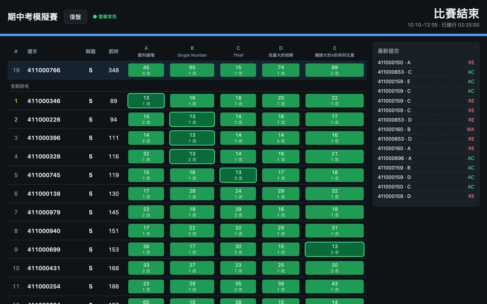
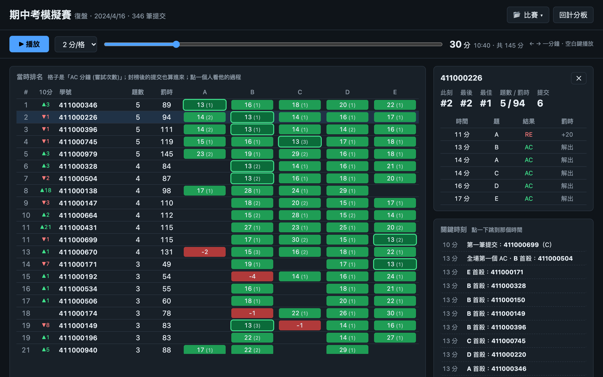
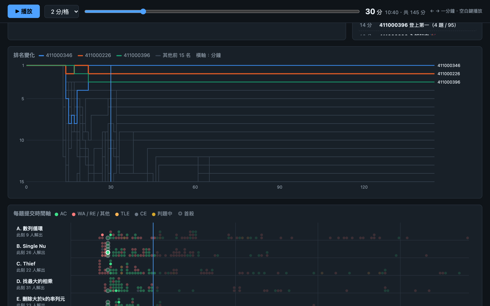
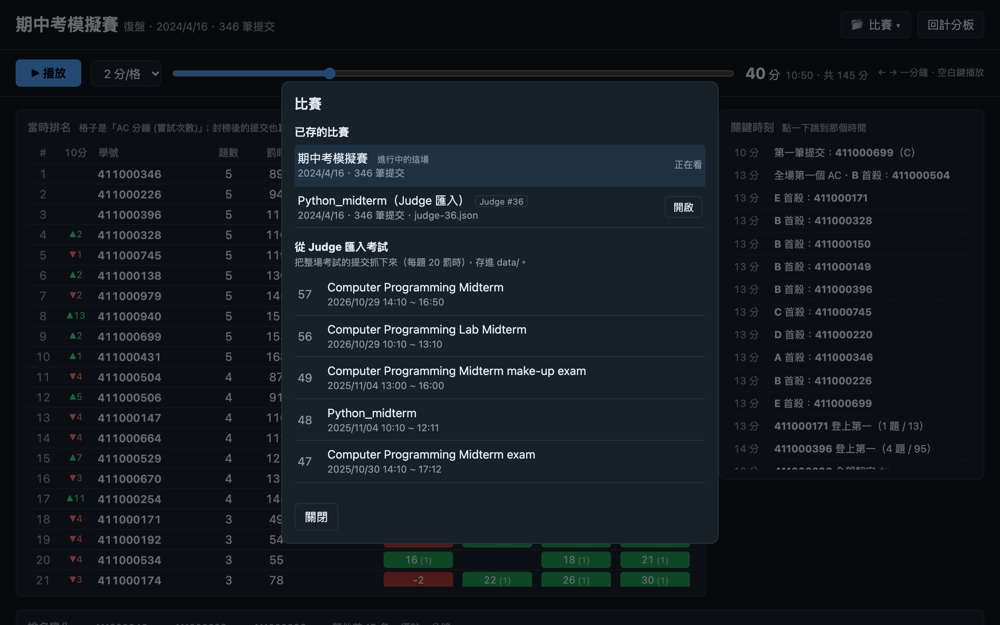

<div align="center">

# 🏆 北大 Judge Girl 練習賽計分板

**給 [北大 Judge Girl](http://120.126.151.220) 用的 ICPC / CPE 風格即時計分板，賽後還能一分鐘一分鐘復盤。**

單一 Python 檔・零套件・打開瀏覽器就能用




</div>

---

> 專門配合 **北大 Judge Girl**（<http://120.126.151.220>）的網頁與 API 寫的：
> 提交紀錄 `/api/submission`、考試清單 `/contest`、考試題目 `/contest/<編號>`。
> 拿去用在其他 Judge 不保證能動。
> 這是學生自己做的練習工具，跟 Judge Girl 官方沒有關係。

## ✨ 功能

| | |
|---|---|
| ⏱️ **即時計分板** | 每 5 秒抓一次 Judge，ICPC 規則排名：解題數 → 罰時 → 最後 AC 時間 |
| 🟩 **CPE 式格子** | 每題顯示 AC 分鐘與嘗試次數，**首殺**特別標示，判題中顯示 `?` |
| ➕ **新增題目** | 輸入題號 `20`、`38/20` 或直接貼網址 `http://…/problem/38/20` |
| 🔍 **自動找人** | 不用名單，有交你選的題目的人自動上榜；從考試頁面交的也抓得到 |
| ⏪ **回推** | 比賽開始後才開程式？給一個起始 SID 或時間，自動翻頁補回所有提交 |
| 📊 **每題統計** | AC / WA / TLE / CE / RE 數量、解出人數、通過率（AC ÷ 提交數） |
| ⭐ **釘選** | 點學號旁的 ☆，那個人固定顯示在最上面（保留真正名次） |
| 🧊 **封榜** | 最後 N 分鐘的提交在榜上和「最新提交」都只顯示 `?` |
| ☕ **螢幕常亮** | Mac 上自動 `caffeinate`，投影時不會進螢幕保護 |
| 🎬 **比賽復盤** | 時間軸拖拉、排名變化圖、每題提交時間軸、個人提交紀錄 |
| 📥 **匯入 Judge 考試** | 一鍵把 Judge 上的期中、期末考整場抓下來復盤 |
| 📂 **存檔管理** | 同一個選單開啟、刪除、另存、匯入比賽 |

## 🚀 快速開始

```bash
git clone <this-repo>
cd scoreboard
python3 scoreboard.py
```

打開 <http://localhost:8000>：

一開始沒有任何題目，照這個順序：

1. **新增題目**：貼上考古題的題號或網址，大概五題
2. **設定**：比賽名稱、開始／結束時間、罰時、封榜時間
3. **開始比賽**：倒數開始，有人交題就會出現在榜上
4. **結束比賽**：比賽時間停在按下去那一刻，榜單和復盤都會留著

再按一次 **開始比賽** 就是新的一場，上一場會自動另存到 `data/`，之後在復盤還看得到。

### 👀 給大家看

同一個網路的人可以用 `http://<你的 IP>:8000` 一起看榜和復盤。
**只有跑程式的那台電腦能按按鈕**（開始、設定、刪檔…），別台電腦看到的是唯讀的畫面。
真的要讓別台電腦也能操作，啟動時設 `SCOREBOARD_LAN_CONTROL=1`，但同網路的任何人就都能改了。

## 🎬 比賽復盤

計分板右上角按 **復盤**，或直接開 <http://localhost:8000/replay>。



- **時間軸**：拖拉或按 ▶ 播放，看第 N 分鐘時的排名；`←` `→` 一次走一分鐘、空白鍵播放
- **10 分鐘排名變化**：▲▼ 一眼看出誰在衝
- **關鍵時刻**：首殺、誰登上第一、第一個全解、最後五分鐘的 AC，點一下就跳過去
- **個人紀錄**：點任何一個人，看他每一筆提交、哪一筆被罰時、哪一筆在 AC 之後不算
- **一開始就列出所有人**：還沒交的格子空白、並列第一，表格不會越播越長；排名表自己捲動，下面的圖不用滑很遠
- **封榜後的提交全部攤開**



- **排名變化圖**：前 15 名的名次曲線，前三名和你點的人上色
- **每題提交時間軸**：每個點是一筆提交，看得出哪一題卡了多少人、什麼時候開始有人解出

### 📂 比賽選單：開啟・刪除・另存・匯入

復盤頁面右上角按 **📂 比賽**，所有存檔的事都在這裡：



- **開啟**：切到另一場比賽復盤
- **刪除**：要按兩次（第二次是「確定刪除？」）；進行中的那場不能刪
- **另存目前這場**：把現在這場複製一份，例如 `data/contest-1029-1410.json`，之後換下一場也還能復盤

### 📥 匯入 Judge 上的考試

同一個選單下半部是 Judge 上的考試清單，選一場（例如 `Python_midterm`）按 **匯入**：

- 從 Judge 的 `/contest` 讀考試清單和時間
- 從考試頁面讀題目
- 把考試時間內的所有提交一頁一頁抓下來，存成 `data/judge-<編號>.json`

匯入完會直接打開，之後也會出現在「已存的比賽」。匯入結果跟 Judge 自己的 Scoreboard 對過，每題解出人數一致。

## 📐 計分規則

跟 ICPC 一樣：

- 排名依序比較 **解題數**（多的前面）→ **罰時**（少的前面）→ **最後一題 AC 的時間**
- 罰時 = 每題 AC 的分鐘數 + AC 前每次錯誤 × 20 分鐘（可在設定改）
- **CE 不罰時**；AC 之後再交的不算
- 解題數和罰時都一樣就並列同名次

## ⚙️ 設定

都用環境變數，不設也可以：

| 變數 | 預設 | 說明 |
|---|---|---|
| `SCOREBOARD_JUDGE` | `http://120.126.151.220` | 北大 Judge Girl 的網址；Judge 換 IP 時改這個 |
| `SCOREBOARD_PORT` | `8000` | 網頁的 port |
| `SCOREBOARD_STATE` | `data/contest.json` | 比賽存檔位置 |
| `SCOREBOARD_AWAKE` | `1` | 設 `0` 就不讓 Mac 保持螢幕常亮 |
| `SCOREBOARD_LAN_CONTROL` | `0` | 設 `1` 讓同網路的其他電腦也能操作（預設只能看） |

```bash
SCOREBOARD_PORT=8080 python3 scoreboard.py
```

## 💾 資料

- 比賽狀態自動存在 `data/contest.json`，程式關掉再開會接著跑
- 按 **開始比賽** 開新的一場時，上一場會自動另存成 `data/contest-<月日>-<時分>.json`；也可以在復盤的 **📂 比賽** 隨時按「另存目前這場」
- `data/` 裡有學生學號，已經寫在 `.gitignore`，**不會被上傳**

## 🗂️ 專案結構

```
scoreboard.py   伺服器：抓 Judge、算排名、API（只用標準函式庫）
index.html      即時計分板
replay.html     比賽復盤
data/           比賽存檔（不上傳）
docs/           README 用的截圖（學號是假的）
```

<details>
<summary><b>API</b></summary>

POST 都要送 `Content-Type: application/json`，而且只接受跑程式的那台電腦（除非設了 `SCOREBOARD_LAN_CONTROL=1`）。

| Method | Path | 說明 |
|---|---|---|
| GET | `/api/board` | 目前的排名、統計、最新提交 |
| GET | `/api/me` | 這台電腦能不能操作 |
| POST | `/api/start` | 開始比賽；`{"sid": 182511}` 或 `{"time": "14:10"}` 回推 |
| POST | `/api/stop` | 結束比賽（比賽長度改成到現在；還沒開始的就取消） |
| POST | `/api/add` | 新增題目 `{"pid": "38/20"}` |
| POST | `/api/remove` | 刪除題目 `{"pid": 20}` |
| POST | `/api/settings` | `title`、`start_time`、`end_time`、`duration_min`、`penalty_min`、`freeze_min`；開始時間沒變就不會重抓 |
| POST | `/api/pin` | 切換釘選 `{"name": "學號"}` |
| GET | `/api/contests` | `data/` 裡可以復盤的比賽 |
| GET | `/api/replay?f=<檔名>` | 一場比賽的所有提交 |
| GET | `/api/judge_contests` | Judge 上的考試清單 |
| POST | `/api/import` | 匯入 Judge 考試 `{"cid": 48}` |
| POST | `/api/snapshot` | 把目前這場另存一份 |
| POST | `/api/delete` | 刪除存檔 `{"file": "judge-48.json"}`（只能刪 `data/` 裡的） |

</details>

<details>
<summary><b>它怎麼抓資料</b></summary>

Judge 的 `/api/submission` 一頁大約 20 筆、新的在前。每次輪詢：

1. 先翻全站提交，翻到上次看過的最新 SID 就停，順便發現有人從哪場考試（cid）交題
2. 再對每一題、每一場考試個別抓，第一頁接不上舊資料就繼續往後翻，直到接上或翻到比賽開始前
3. 還在判題中的舊提交會一直更新到出結果

比賽結束 30 分鐘後就停止輪詢。

</details>

## 📄 授權

[MIT](LICENSE)
